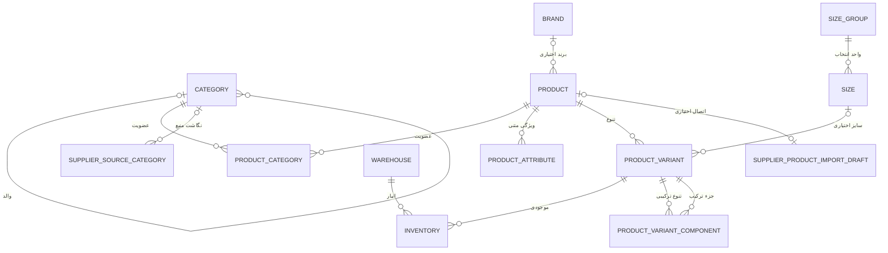

# CAT-01 — ممیزی کاتالوگ و قرارداد داده

خط مبنا `main@e0d268d` و تاریخ ممیزی ۲۰۲۶-۱۱-۱۹ به وقت تهران. گزارش ابتدا روی `feature/roadmap-execution` آماده شد و اعتبارسنجی نهایی روی `seo-fix` انجام شد. وضعیت ممیزی `DONE` است. شواهد از Schema و سرویس‌های مخزن، تست‌های موجود و نمونه‌برداری خواندنی از API عمومی به‌دست آمدند. قرارداد و طرح مهاجرت برای بررسی‌اند.

## مدل و مسیرهای فعلی

| مرز          | قرارداد موجود و اثر آن                                                                                                                                                                                                                                                                                                                                                                                                                                                                                                                                                                              |
| ------------ | --------------------------------------------------------------------------------------------------------------------------------------------------------------------------------------------------------------------------------------------------------------------------------------------------------------------------------------------------------------------------------------------------------------------------------------------------------------------------------------------------------------------------------------------------------------------------------------------------- |
| دسته و برند  | `Category.parentId`، `sortOrder`، وضعیت فعال و حذف نرم وجود دارند. Slug دسته در کل مدل یکتاست و `ProductCategory(productId, categoryId)` عضویت چنددسته‌ای را نگه می‌دارد. برند اختیاری و مستقل از دسته است. [Prisma](../../../apps/api/prisma/schema.prisma)                                                                                                                                                                                                                                                                                                                                        |
| ادمین        | مدیریت دسته والد فعال، جلوگیری از چرخه، تغییر ترتیب، غیرفعال‌سازی و آرشیو با کنترل فرزند/محصول، و ثبت Redirect هنگام تغییر Slug را پوشش می‌دهد. فرم محصول دسته‌های متعدد، برند، SEO، ویژگی مرتب‌شده و تنوع با SKU/وزن/سایز را ثبت می‌کند. [CatalogCategoriesService](../../../apps/api/src/modules/catalog/catalog-categories.service.ts) · [فرم دسته](../../../apps/admin/src/components/categories/category-management-view.tsx) · [فرم محصول](../../../apps/admin/src/components/products/product-form.tsx)                                                                                      |
| API          | `GET /api/v1/catalog/public/{categories,brands,products}`، جزئیات `products/:slug` و پیشنهاد جست‌وجو قراردادهای عمومی‌اند. فهرست محصولات با `category`، `brand`، `country`، `q`، `sort`، `page` و `pageSize` کار می‌کند. فیلتر دسته زیرشاخه‌های فعال را می‌پیماید. پاسخ دسته `hasProducts` را به اجداد منتقل می‌کند. شمارش Facet مستقل در این قرارداد وجود ندارد. [Controller](../../../apps/api/src/modules/catalog/catalog.controller.ts) · [Service](../../../apps/api/src/modules/catalog/catalog.service.ts) · [DTO](../../../apps/api/src/modules/catalog/dto/public-catalog-response.dto.ts) |
| Storefront   | URL محصول، دسته و برند از `/products/{slug}`، `/categories/{slug}` و `/brands/{slug}` می‌آید. Breadcrumb محصول دستهٔ فعالِ عمیق‌تر را انتخاب می‌کند و تساوی با ترتیب و نام فارسی رفع می‌شود. دستهٔ اصلی در DB ثبت نمی‌شود. تغییر والد می‌تواند Breadcrumb یا نتیجهٔ دسته را عوض کند، حتی با Slug ثابت. [منطق فهرست و Breadcrumb](../../../apps/storefront/src/lib/catalog/public-catalog.ts) · [صفحهٔ محصول](<../../../apps/storefront/src/app/(shop)/products/[slug]/page.tsx>)                                                                                                                    |
| ویژگی و سایز | `ProductAttribute` کلید و مقدار رشته‌ای و ترتیب یکتا برای هر محصول دارد. Service فاصله و کلید تکراری را کنترل می‌کند. نوع داده، واحد، Taxonomy ویژگی و جنسیت ساختاریافته وجود ندارند. وزن واریانت گرم با دقت سه اعشار است. `Size/SizeGroup` و حالت‌های `NONE/FREE_SIZE/SIZED` ساختاریافته‌اند. [Schema](../../../apps/api/prisma/schema.prisma) · [Service](../../../apps/api/src/modules/catalog/catalog.service.ts)                                                                                                                                                                               |

## انتشار، موجودی و منبع تأمین

- **انتشار**. Lookup عمومی فقط محصول `ACTIVE` و حذف‌نشده را می‌خواند. `DRAFT` و `ARCHIVED` وضعیت انتشارند. محصول فعال می‌تواند با موجودی صفر همچنان در کاتالوگ ظاهر شود.
- **واریانت و موجودی**. برای واریانت `OWN` مانده قابل فروش از مجموع `max(0, onHand - reserved)` در انبارهای فعال حاصل می‌شود. برای `COMPONENTS` کمترین ظرفیت از تقسیم موجودی هر جزء بر تعداد مصرف آن تعیین می‌شود. جزء غیرفعال/حذف‌شده ظرفیت صفر دارد. در خروجی جزئیات، محصول `SIMPLE` مجموع ماندهٔ تنوع‌ها و `COMPOSITE` بیشترین ماندهٔ گزینه‌ها را نشان می‌دهد تا موجودی مشترک دوبار شمرده نشود. شرط فیلتر سایز/وزن باید روی همان واریانتِ واجد موجودی اعمال شود. [CatalogService](../../../apps/api/src/modules/catalog/catalog.service.ts) · [الزامات رزرو ترکیب](../../../apps/api/src/modules/inventory/variant-inventory-requirements.ts)
- **قیمت صفر تأمین‌کننده**. مدل Draft قیمت مشاهده‌شده و `sourceAvailability` را جدا نگه می‌دارد. SaatYek مبلغ تبدیل‌شدهٔ صفر یا یک تومان را `null` و `rejectedSentinelPrice` ثبت می‌کند، ولی Availability را از Offer می‌خواند. BSJ عدد قابل‌تجزیه، از جمله صفر، را ذخیره می‌کند و Availability را جدا از دادهٔ ساختاریافته می‌گیرد. فرم Admin قیمت تأمین‌کننده را برای مقایسه نشان می‌دهد و در قیمت فروش کپی نمی‌کند. نتیجهٔ ممیزی برای CAT-03/04 این است که صفر را سیگنال منبع با منشأ نگه داریم. فقط با شاهد مستند برای همان Adapter به `OUT_OF_STOCK` نگاشت شود و چرخهٔ ثبت موجودی داخلی مستقل بماند. [SaatYek](../../../apps/api/src/modules/supplier-imports/adapters/saatyek-crawler.adapter.ts) · [BSJ](../../../apps/api/src/modules/supplier-imports/adapters/bsj-silver-crawler.adapter.ts) · [جریان Draft](../../../apps/api/src/modules/supplier-imports/supplier-imports.service.ts)

## نمونه‌برداری واقعی

در ۱۹ نوامبر، برای هر دسته دو ردیف نخست خروجی عمومی با `page=1&pageSize=2` و مرتب‌سازی پیش‌فرض خوانده شدند. هر ۱۰ درخواست جزئیات HTTP 200 داشتند و در زمان نمونه‌گیری موجود بودند. این نمونهٔ کوچکِ فهرست عمومی، کیفیت کل موجودی یا داده‌های Draft را برآورد نمی‌کند. عدد هر دسته `total` همان فیلتر است و یک محصول می‌تواند در چند دسته شمارش شود.

| دسته و تعداد فهرست            | دو رکورد                                                                                   | مشاهده                                                                                                                                                                                                                        |
| ----------------------------- | ------------------------------------------------------------------------------------------ | ----------------------------------------------------------------------------------------------------------------------------------------------------------------------------------------------------------------------------- |
| دستبند `bracelets`، ۱۳۲       | `arvin-chevron-silver-bracelet`، `vancleef-five-flower-gold`                               | آروین ۴۴ گرم، طول ۲۳ سانتی‌متر و «جنس: نقره ۹۲۵» دارد. ونکیف ۷٫۵ گرم است و Attributes و سایز ندارد. عنوان فارسیِ آن «دستبند نقره» را مشخص می‌کند و Slug نوع/جنس را حمل نمی‌کند. Slug فعلی حفظ شود.                            |
| گردنبند `necklaces`، ۱۵۵      | `alivora-gold-oval-link-silver-necklace`، `orion-gold-plated-cartier-silver-necklace`      | هر دو طول ۶۰ سانتی‌متر دارند. وزن‌ها ۱۳٫۶۸ و ۳۷٫۷۰ گرم‌اند. کلید «نوع بافت» در کنار «مدل بافت» دستبند به نگاشت دسته‌محور و بازبینی اپراتور نیاز دارد.                                                                         |
| انگشتر `rings`، ۱۲            | `ga-quadra-silver-ring`، `lumina-quadra-silver-ring`                                       | اولی عنوان عمومی «انگشتر آیینه ای»، حالت `FREE_SIZE`، وزن ۴ گرم و جنس/عیار جدا دارد. دومی سایز گروه RING برابر ۸٫۵، وزن ۲٫۸ و «محیط داخلی تقریبی: ۵۹ میلی‌متر» دارد. محیط تقریبی و کد سایز دو مقدار مستقل با منشأ متفاوت‌اند. |
| گوشواره `silver-earrings`، ۲۰ | `aquaria-blue-opal-silver-drop-earrings`، `silver-micro-rhodium-threader-earrings-model-1` | وزن‌ها ۳٫۵۵ و ۳٫۰۳ گرم‌اند. هر دو `NONE` و دارای جنس و عیار مجزا هستند. «قابل استفاده برای: بانوان» فقط در نمونهٔ اول ثبت شده است.                                                                                            |
| ساعت `watch`، ۱۵۹             | `casio-efr-539de-2a-watch`، `casio-efb-109d-2a-watch`                                      | وزن‌ها ۱۸۴ و ۱۲۷ گرم‌اند. هر دو جنسیت، نوع موتور، جنس بند/شیشه و مقاومت «۱۰ بار (۱۰۰ متر)» را متن آزاد دارند. دسته‌های جاری ساعت زنانه، مردانه و ست زیر والد `watch` هستند.                                                   |

## قرارداد پیشنهادی برای CAT-02/03/04

1. شناسه و Slug هر دسته و محصول و رابطه‌های فعلی حفظ شوند. اگر انتخاب صریح دستهٔ اصلی تأیید شد، فقط از میان عضویت‌های فعال محصول باشد و هنگام حذف آن، انتخاب فعلی Storefront به‌عنوان fallback استفاده شود. شمارش «مستقیم یا شامل زیرشاخه» در قرارداد API صریح و با شناسهٔ محصول یکتا باشد.
2. Attribute Registry در امتداد Catalog موجود یک کد پایدار، نوع، واحد استاندارد، مجموعهٔ دسته‌های مجاز، گزینه‌ها و ترتیب نمایش داشته باشد. مقدار متنی کنونی برای نمایش/بازگشت و ممیزی نگه داشته شود. مقدار نوع‌دار پس از نگاشت با منشأ، نسخه و وضعیت تأیید ارائه شود. برای وزن از `weightGrams` و برای سایز یا طول از `Size/SizeGroup` استفاده شود. مقدار نامعلوم `null` است. استخراج عنوان به‌تنهایی موجب تأیید مقدار نشود.
3. «قابل استفاده برای» یک ویژگی محصول با گزینه‌های مصوب است. برای مثال «بانوان» و «آقایان» به کدهای مشخص نگاشت می‌شوند. جنسیت از نبود داده، نام، رنگ یا دستهٔ ساعت ست استنباط نشود. «ست» می‌تواند ویژگی عرضه یا بسته‌بندی باشد و باید تصمیم مستقل داشته باشد.
4. Storefront و Admin از قرارداد تولیدشدهٔ OpenAPI استفاده کنند. پاسخ فعلی سازگار بماند و فیلدهای جدید افزایشی باشند. API تنها منبع ارزیابی موجودی و شروط هم‌زمان روی یک واریانت است. فیلتر ادعای «قابل خرید» را فقط با واریانت قابل فروش ارائه کند. مدل انتشار، مانده و مشاهدهٔ منبع سه ورودی مستقل‌اند.

### نمونهٔ پیش و پس از نگاشت پیشنهادی

| رکورد           | پیش از نگاشت                                                       | نمایش مفهومی پس از نگاشت                                                                                                                       |
| --------------- | ------------------------------------------------------------------ | ---------------------------------------------------------------------------------------------------------------------------------------------- |
| دستبند آروین    | `جنس=نقره ۹۲۵`، اندازهٔ «۲۳ سانتی متر»، `weightGrams=44`، ماندهٔ ۳ | `material=SILVER` و `fineness=925` پس از تأیید، `lengthMm=230` با نگاشت گروه طول، و همان وزن، واریانت و مانده                                  |
| دستبند ونکیف    | بدون Attribute، `NONE`، وزن ۷٫۵                                    | `material=null` و `fineness=null` تا بررسی. عنوان، وزن و URL فعلی حفظ شوند.                                                                    |
| گوشواره آکواریا | `جنس=نقره`، `عیار=۹۲۵` و `قابل استفاده برای=بانوان`                | `material=SILVER`، `fineness=925` و `intendedFor=[WOMEN]` پس از تأیید. اندازه «قابل اعمال نیست» به تناسب Registry.                             |
| ساعت کاسیو EFR  | `جنسیت=مردانه` و `مقاومت در برابر آب=۱۰ بار (۱۰۰ متر)`             | کد گزینهٔ تأییدشده برای مخاطب و مقدار فشار `10 bar` با نگهداشت متن منبع. تبدیل یا نتیجه‌گیری دربارهٔ شرایط استفاده از متن نمونه انجام نمی‌شود. |

## ریسک و برنامهٔ بازگشت

| تغییر پیشنهادی               | شاهد و ریسک                                                                                                                                                                                      | کنترل و بازگشت                                                                                                                                                                         |
| ---------------------------- | ------------------------------------------------------------------------------------------------------------------------------------------------------------------------------------------------ | -------------------------------------------------------------------------------------------------------------------------------------------------------------------------------------- |
| انتقال زیرشاخه یا ادغام دسته | رابطه‌ها در DB و فهرست به شناسه تعلق دارند. جابه‌جایی بدون تغییر Slug نیز Breadcrumb، تعداد و نمایش زیرشاخه را عوض می‌کند. وابستگی‌های راهنما، صفحهٔ خانه و نگاشت تأمین‌کننده هم باید دیده شوند. | Dry Run با شمارش عضویت، والد، محصول یکتا و پیوندهای عمومی پیش/پس. نگاشت شناسه و Snapshot وابستگی ثبت شود. تغییر دسته با همان Slug اولویت دارد.                                         |
| تغییر Slug یا حذف دسته       | Slug جزئی از URL جاری است. تغییر آن روی Canonical، Sitemap، تغییرمسیر قبلی و لینک داخلی اثر دارد. آرشیو فعلی در حضور فرزند یا محصول رد می‌شود.                                                   | فقط در صورت نیاز و پس از تأیید، نگاشت مبدأ به مقصد معتبر و Redirect تک‌مرحله‌ای بررسی شود. قبل از هر انتشار HTTP، مقصد، Canonical و Breadcrumb کنترل شوند. [گیت سئو](SEO-01.md)        |
| Backfill ویژگی               | چند نمایش برای جنس و عیار، کلیدهای مشابه و مقادیر خالی در نمونه‌ها دیده شد. نگاشت غلط نتیجهٔ فیلتر و کمپین را عوض می‌کند.                                                                        | در مهاجرت افزایشی، مقادیر اولیه حفظ و موارد مبهم برای بررسی ثبت شوند. اجرای دوباره idempotent باشد و امکان خاموش‌کردن مصرف مقدار نوع‌دار وجود داشته باشد.                              |
| فیلتر تنوع یا تبدیل قیمت صفر | اتصال وزن/اندازه به واریانت دیگر، نادیده‌گرفتن رزرو/اجزا یا تبدیل صفر به ماندهٔ فروش باعث نتیجهٔ کاذب می‌شود.                                                                                    | نمونهٔ Race/رزرو، محصول فعال ناموجود، اندازهٔ ناموجود در محصول موجود، ترکیب مشترک و تضاد قیمت/Availability تأمین‌کننده در تست پوشش داده شوند. تغییر موجودی فقط از مسیر فعلی Inventory. |

## آزمون و مرز پذیرش

- API، کاتالوگ، موجودی و واردسازی تأمین‌کننده با `pnpm api:test --runInBand modules/catalog modules/inventory modules/supplier-imports`، ۱۰۷ تست موفق از ۱۶ مجموعه.
- فرم محصول و مدیریت دستهٔ Admin، ۱۳ تست Vitest موفق. قرارداد فهرست و Breadcrumb در Storefront، ۸ تست Vitest موفق.
- پس از انتقال به `seo-fix`، اجرای دستی آزمون‌های مرتبط API، Admin و Storefront به گزارش مدیر پروژه موفق بود.
- دادهٔ نمونه از API عمومی دریافت شد. نرخ کامل کیفیت کاتالوگ و رفتار داده‌های خصوصی Draft در این ممیزی اندازه‌گیری نشد. پیش از Migration، قرارداد شمارش دسته، انتخاب دستهٔ اصلی و نگاشت Sentinel هر تأمین‌کننده بازبینی شوند.
- خروجی این تسک گزارش، نمودار روابط، نمونهٔ پیش/پس و ماتریس ریسک است. در این مرحله تغییر Schema، بک‌فیل، تغییر Slug یا تغییر روی Production اجرا نشد.
